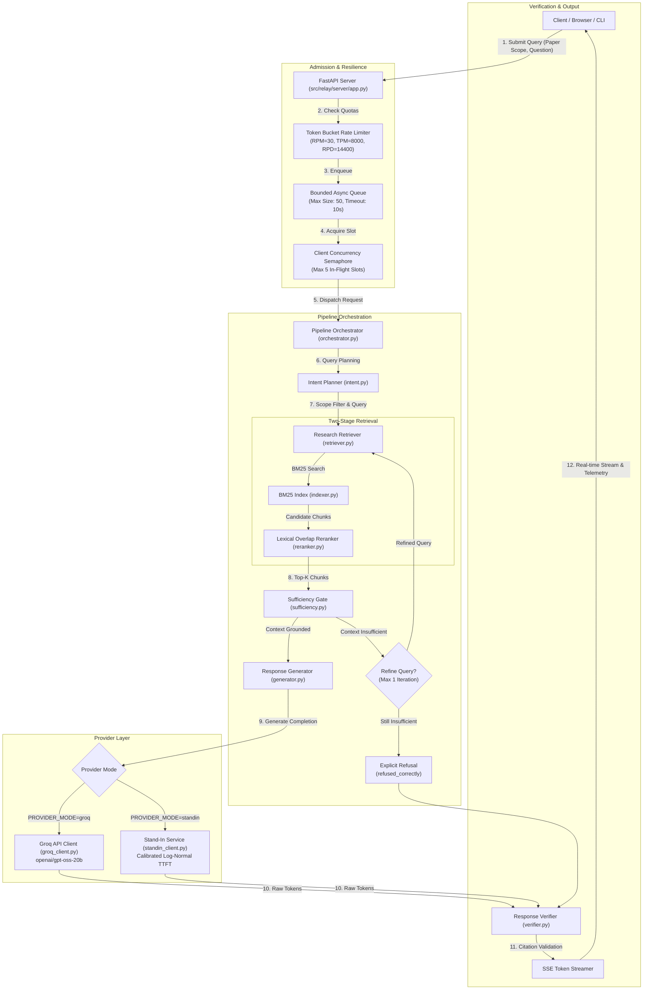

# The Relay: Resilient LLM Pipeline & Research Assistant

[](https://www.python.org/downloads/)
[](https://fastapi.tiangolo.com)
[](https://docs.pytest.org/)
[](https://docs.pydantic.dev/)

> **A production-minded, rate-limit-aware LLM pipeline and research assistant engineered for technical question answering grounded strictly in arXiv preprints, featuring admission control, empirical stand-in calibration, and real-time streaming telemetry.**

---

## Table of Contents

- [1. Project Overview](#1-project-overview)
- [2. Key Features](#2-key-features)
- [3. Research Library](#3-research-library)
- [4. System Architecture](#4-system-architecture)
- [5. Technology Stack](#5-technology-stack)
- [6. Repository Structure](#6-repository-structure)
- [7. Prerequisites](#7-prerequisites)
- [8. Installation and Setup](#8-installation-and-setup)
- [9. Environment Configuration](#9-environment-configuration)
- [10. Running The Relay (Application & UI)](#10-running-the-relay-application--ui)
- [11. Interactive CLI](#11-interactive-cli)
- [12. API Documentation](#12-api-documentation)
- [13. Testing](#13-testing)
- [14. Experiments and Benchmarking](#14-experiments-and-benchmarking)
- [15. Results and Evaluation](#15-results-and-evaluation)
- [16. Project Artifacts](#16-project-artifacts)
- [17. Troubleshooting](#17-troubleshooting)
- [18. Security and Responsible Usage](#18-security-and-responsible-usage)
- [19. Limitations and Future Improvements](#19-limitations-and-future-improvements)
- [20. License and Maintainer](#20-license-and-maintainer)

---

## 1. Project Overview

### What is The Relay?
**The Relay** is an asynchronous, paper-grounded research assistant and LLM reliability engineering framework. It couples a grounded Retrieval-Augmented Generation (RAG) pipeline with proactive client-side admission control, quota tracking, bounded queueing, and citation verification.

### What problem does it address?
Deploying Large Language Models in production or using high-speed inference engines (such as Groq LPUs) introduces harsh operational boundaries:
1. **Aggressive Provider Quotas:** Upstream APIs impose strict rate limits across multiple dimensions simultaneously: Requests Per Minute (RPM), Tokens Per Minute (TPM), Requests Per Day (RPD), and Daily Token Budgets (TPD).
2. **Cascading Failures:** When traffic spikes, naive clients trigger bursts of HTTP `429 Too Many Requests`. Blind retries amplify load, collapsing client performance and degrading availability.
3. **Hallucination and Ungrounded Claims:** Standard RAG pipelines frequently synthesize speculative answers when the retrieved context lacks sufficient evidence.
4. **Evaluation Leakage:** Standard benchmarks often mistake operational dropouts (such as rate-limit rejections or network timeouts) for incorrect model answers, polluting quality metrics.

### How does The Relay solve this?
The Relay bridges these challenges through an integrated architecture:
- **Proactive Admission Control:** Tracks RPM, TPM, and RPD locally using in-memory token buckets, rejecting or queueing queries *before* exhausting upstream provider quotas.
- **Bounded Queueing & Jittered Retries:** Spikes are absorbed in an asynchronous bounded FIFO queue (capacity 50, 10s deadline), while transient errors trigger exponential backoff with decorrelated jitter.
- **Strict Evidence Sufficiency Gate:** Before calling the LLM, a dedicated sufficiency evaluator verifies that retrieved passages establish the necessary facts. If context is insufficient, an autonomous one-iteration query refinement loop is triggered; if still ungrounded, the system issues an explicit, honest refusal (`refused_correctly`) rather than hallucinating.
- **Empirical Stand-in Calibration:** A local simulator calibrated directly against real Groq LPU latency distributions and rate-limit headers allows full offline benchmarking without consuming live API tokens.
- **Clean Evaluation Boundary:** Operational failures are categorized strictly into `operational_rejection` and `operational_timeout`, guaranteeing that throughput limits never bias retrieval accuracy or citation precision metrics.

---

## 2. Key Features

- **Paper-First Research Interface:** A clean, responsive web interface (`http://127.0.0.1:8000`) designed around an explicit paper-first workflow. Users select a paper scope, ask questions, and receive streaming answers with citation pill badges and latency telemetry.
- **Scope-Constrained Retrieval:** Strict backend scope enforcement. When a user selects a single paper, retrieval is restricted exclusively to that paper. Cross-paper mode enables comparative retrieval across all ingested papers.
- **Two-Stage Retrieval Pipeline:** Boundary-aware PDF section parsing and character chunking, indexed via BM25 lexical search and re-ranked using cross-scoring lexical overlap.
- **Autonomous Sufficiency Gate:** Evaluates whether retrieved chunks establish sufficient grounding. When ambiguous or partial, it initiates a single-iteration query expansion; when unanswerable, it generates a refusal.
- **Citation Auditor & Fact Verifier:** Inspects generated answers to ensure every factual claim cites a valid section and matches the retrieved evidence chunks.
- **Dual-Provider Architecture:**
  - **Live Groq Provider:** Connects to Groq's high-speed LPU inference API (`openai/gpt-oss-20b`), streaming tokens over HTTP.
  - **Calibrated Stand-In:** An offline simulator fitted to real Groq LPU response measurements via log-normal latency distributions, chunked SSE generation, and rate-limit counters.
- **Real-Time Token Streaming (SSE):** Token-by-token streaming over Server-Sent Events (`/api/query/stream` and `/v1/chat/completions`) transmitting chunk increments, citation metadata, and timing benchmarks.
- **Resilience Engine:** Multi-dimensional token-bucket rate limiter (RPM/TPM/RPD), client-side concurrency semaphore (5 slots), bounded priority queue (capacity 50, 10-second wait limit), and retry policies with decorrelated jitter.
- **Integrated Evaluation Dashboard:** Built-in web dashboard displaying real provider limits (Table 1), load test results across 5 scenarios (Tables 2a & 2b), retrieval configuration trade-offs (Table 3), slow request latency decomposition, and searchable raw query records.
- **Interactive Terminal CLI:** Standalone CLI (`scripts/interactive_cli.py`) supporting paper selection, streaming answers, citation inspection, and latency metrics.

---

## 3. Research Library

The system is grounded exclusively in three exact arXiv preprints stored in `data/papers/`. Their metadata and SHA-256 integrity checksums are registered in `data/metadata.json`:

| # | Paper Title | arXiv ID | Exact Version Link | Primary Domain |
|---|-------------|----------|-------------------|----------------|
| 1 | **Attention Is All You Need** | `1706.03762v7` | [arXiv:1706.03762v7](https://arxiv.org/abs/1706.03762v7) | Transformer Architecture, Self-Attention, Multi-Head Attention |
| 2 | **Moshi: a speech-text foundation model for real-time dialogue** | `2410.00037v1` | [arXiv:2410.00037v1](https://arxiv.org/abs/2410.00037v1) | Full-Duplex Spoken Dialogue, Mimi Audio Codec, Helium LLM |
| 3 | **Dynamic Chunking for End-to-End Hierarchical Sequence Modeling** | `2507.07955v2` | [arXiv:2507.07955v2](https://arxiv.org/abs/2507.07955v2) | Dynamic Compression, Hierarchical Sequence Modeling, Pointers |

### Retrieval Scope Enforcement
- **Single-Paper Mode:** Constrains BM25 search exclusively to the selected document's chunks. Chunks from other documents are excluded at the index filter level.
- **Cross-Paper Mode:** Pools chunks across all three papers, enabling comparative queries (e.g., contrasting attention mechanisms between Transformers, Moshi, and Dynamic Chunking).
- **Out-of-Scope Queries:** When a query targets a concept absent from the selected scope, the pipeline refuses the question rather than retrieving irrelevant passages.

---

## 4. System Architecture

The following diagram illustrates the end-to-end request lifecycle through The Relay pipeline:



### Process-Local Concurrency Architecture
All admission controls, queue buffers, and rate-limit tracking are implemented in-process using Python's `asyncio` primitives (`asyncio.Semaphore`, `asyncio.Queue`, and monotonic timestamps). The system requires no external Redis, Celery, or database services to run.

---

## 5. Technology Stack

| Layer / Role | Technology | Minimum Version | Description & Rationale |
|---|---|---|---|
| **Runtime** | Python | `>=3.11` | Core language runtime utilizing modern `asyncio` and typing |
| **Web Framework** | FastAPI | `>=0.115.0` | Asynchronous HTTP endpoints and OpenAPI documentation |
| **ASGI Server** | Uvicorn | `>=0.34.0` | High-performance asynchronous server running Starlette |
| **Validation** | Pydantic / Settings | `>=2.10.0` / `>=2.7.0` | Strict schema validation, request models, and `.env` parsing |
| **HTTP Client** | HTTPX | `>=0.28.0` | Asynchronous HTTP client with connection pooling for Groq API |
| **PDF Extraction** | PyPDF | `>=5.1.0` | Local PDF text and metadata extraction with page numbering |
| **Lexical Search** | Rank-BM25 | `>=0.2.2` | Fast, deterministic in-memory BM25Okapi scoring algorithm |
| **Math & Profiling** | NumPy | `>=2.0.0` | Numerical calculations for log-normal calibration and percentiles |
| **PDF Generation** | ReportLab | `>=4.2.0` | 2-page research PDF report compilation and layout engine |
| **Image Processing** | Pillow | `>=10.4.0` | Image handling for PDF report generation |
| **Testing** | Pytest / Asyncio | `>=8.3.0` / `>=0.25.0` | Asynchronous test framework verifying pipeline invariants |

---

## 6. Repository Structure

```text
The_Relay_Assignment/
├── .env.example                     # Environment template (safe placeholders)
├── .gitignore                       # Git exclusion rules (ignores secrets & caches)
├── pyproject.toml                   # Python build manifest & dependencies
├── README.md                        # Primary project documentation & onboarding
├── results.csv                      # Raw telemetry dataset (184 benchmark requests)
├── The_Relay_Assignment_Brief.pdf   # Original technical assignment specification
├── The_Relay_Report.pdf             # Precompiled official 2-page summary report
│
├── data/
│   ├── calibration_profile.json     # Empirical log-normal distribution parameters
│   ├── evaluation_set.json          # 18 curated ground-truth test queries
│   ├── metadata.json                # Ingested paper metadata, URLs, and SHA-256 hashes
│   ├── real_groq_probes.csv         # Measured live probe requests and rate-limit headers
│   ├── real_groq_probes.json        # Detailed JSON logs of live Groq LPU probes
│   ├── archive/
│   │   └── results_pre_audit.csv    # Historical telemetry benchmark archive
│   └── papers/                      # Local PDF copies of the 3 arXiv research preprints
│       ├── 1706.03762v7.pdf
│       ├── 2410.00037v1.pdf
│       └── 2507.07955v2.pdf
│
├── src/relay/
│   ├── __init__.py                  # Package initialization
│   ├── config.py                    # Pydantic Settings & environment validation
│   ├── logging_setup.py             # Monotonic timing & structured console logging
│   ├── schemas.py                   # Domain models, CSV telemetry schemas, Enums
│   ├── evaluation/
│   │   ├── calibration.py           # Calibration fitter & log-normal parameter estimator
│   │   ├── metrics.py               # Statistical computations (p50, p95, success rates)
│   │   └── quality_evaluator.py     # Independent citation & grounded answer scorer
│   ├── ingestion/
│   │   ├── chunker.py               # Boundary-aware section and character chunker
│   │   └── extractor.py             # PyPDF text extraction & metadata reader
│   ├── pipeline/
│   │   ├── generator.py             # Response synthesis & prompt engineering
│   │   ├── intent.py                # Intent planner & query disambiguation
│   │   ├── orchestrator.py          # Master coordinator tying retrieval, gate & LLM
│   │   ├── sufficiency.py           # Context sufficiency evaluator & refinement loop
│   │   └── verifier.py              # Citation auditor & ground-truth verification
│   ├── provider/
│   │   ├── base.py                  # Abstract base class for LLM providers
│   │   ├── groq_client.py           # Real Groq LPU API client with streaming
│   │   ├── groq_prober.py           # Probe harness recording rate-limit headers & TTFT
│   │   └── standin_client.py        # Calibrated stand-in simulating LPU latency & quotas
│   ├── resilience/
│   │   ├── queue_manager.py         # Bounded FIFO queue with wait deadlines
│   │   ├── rate_limiter.py          # Multi-dimensional token-bucket rate limiter
│   │   └── retry_policy.py          # Exponential backoff with decorrelated jitter
│   ├── retrieval/
│   │   ├── indexer.py               # In-memory BM25Okapi document indexer
│   │   ├── reranker.py              # Cross-scoring lexical overlap re-ranker
│   │   └── retriever.py             # Paper-scoped retrieval tool interface
│   └── server/
│       ├── app.py                   # FastAPI application & REST/SSE endpoints
│       ├── dashboard_service.py     # In-memory benchmark summary & CSV record query engine
│       └── templates/
│           └── index.html           # Paper-first assistant UI & evaluation dashboard
│
├── scripts/
│   ├── generate_pdf_report.py       # Compiles The_Relay_Report.pdf from LaTeX/ReportLab
│   ├── ingest_papers.py             # Downloads arXiv PDFs & verifies SHA-256 hashes
│   ├── interactive_cli.py           # Terminal interface for testing the research assistant
│   ├── run_all_experiments.py       # Master harness generating results.csv (184 requests)
│   ├── run_load_scenarios.py        # Executes 5 load stress scenarios (120 requests)
│   ├── run_real_probes.py           # Queries live Groq API to record empirical telemetry
│   └── run_retrieval_benchmarks.py  # Evaluates Small, Balanced, and Large retrieval configs
│
└── tests/
    ├── test_frontend_api.py         # Verifies UI serving, paper scopes & dashboard APIs
    ├── test_ingestion.py            # Validates PDF parsing and chunk metadata
    ├── test_metrics.py              # Checks telemetry recording and math calculations
    ├── test_no_leakage.py           # Confirms operational failures never count as wrong answers
    ├── test_pipeline.py             # Tests answerable, unanswerable, and off-topic flows
    ├── test_resilience.py           # Verifies rate limiting, queue drops, and retries
    ├── test_retrieval.py            # Tests BM25 indexing, re-ranking, and sufficiency
    ├── test_standin.py              # Validates stand-in log-normal latency & quota rejection
    └── test_streaming_server.py     # Confirms genuine multi-chunk SSE token streaming
```

---

## 7. Prerequisites

Before installing, ensure your environment meets the following requirements:
- **Operating System:** Windows 10/11, macOS, or Linux.
- **Python:** Version `3.11` or higher is strictly required (per `pyproject.toml`). Check your version:
  ```bash
  python --version
  ```
- **Git:** Installed and available on your system `PATH`.
- **Groq API Key (Optional):** If you wish to query the real Groq LPU service, obtain a free API key at [console.groq.com/keys](https://console.groq.com/keys). If you do not have a key, the project runs fully offline out of the box using `PROVIDER_MODE=standin`.

---

## 8. Installation and Setup

Follow these steps to set up a clean development environment:

### Windows (PowerShell)

```powershell
# 1. Clone the repository
git clone https://github.com/Rohitk69992/Relay-Assignment.git
cd Relay-Assignment

# 2. Create a virtual environment with Python 3.11+
python -m venv .venv

# 3. Activate the virtual environment
.\.venv\Scripts\Activate.ps1
# If PowerShell displays an Execution Policy warning, run:
# Set-ExecutionPolicy -Scope Process -ExecutionPolicy RemoteSigned

# 4. Upgrade pip and install package in editable mode with development tools
python -m pip install --upgrade pip
pip install -e ".[dev]"

# 5. Verify installation
python -c "import relay; print('The Relay successfully installed from:', relay.__file__)"
```

### macOS / Linux (Bash / Zsh)

```bash
# 1. Clone the repository
git clone https://github.com/Rohitk69992/Relay-Assignment.git
cd Relay-Assignment

# 2. Create a virtual environment with Python 3.11+
python3 -m venv .venv

# 3. Activate the virtual environment
source .venv/bin/activate

# 4. Upgrade pip and install package in editable mode with development tools
python -m pip install --upgrade pip
pip install -e ".[dev]"

# 5. Verify installation
python -c "import relay; print('The Relay successfully installed from:', relay.__file__)"
```

---

## 9. Environment Configuration

The application reads its settings from environment variables or a local `.env` file located in the repository root.

### Creating your `.env` file

Copy the provided `.env.example` template:

```bash
# On Linux / macOS:
cp .env.example .env

# On Windows PowerShell:
Copy-Item .env.example .env
```

If `.env.example` is not present, create a new file named `.env` in the project root with the following content:

```ini
# ==============================================================================
# The Relay Configuration
# ==============================================================================

# Groq API Configuration (Optional: runs standalone simulation if omitted)
GROQ_API_KEY=your_groq_api_key_here
GROQ_BASE_URL=https://api.groq.com/openai/v1
GROQ_MODEL=openai/gpt-oss-20b

# Provider Mode: "standin" (offline simulation) or "groq" (live API)
PROVIDER_MODE=standin

# Rate Limiting & Concurrency Safety Limits (Groq Free Tier)
RATE_LIMIT_RPM=30
RATE_LIMIT_TPM=8000
RATE_LIMIT_RPD=14400
RATE_LIMIT_TPD=500000
MAX_CONCURRENT_REQUESTS=5
MAX_QUEUE_SIZE=50
QUEUE_TIMEOUT_SECONDS=10.0
REQUEST_TIMEOUT_SECONDS=30.0

# Retry Policy
MAX_RETRIES=3
RETRY_BASE_DELAY_SECONDS=0.5
RETRY_MAX_DELAY_SECONDS=5.0
RETRY_JITTER=0.2

# Retrieval Defaults
DEFAULT_CHUNK_SIZE=600
DEFAULT_CHUNK_OVERLAP=100
DEFAULT_TOP_K=4
DEFAULT_RERANK_ENABLED=true

# Server Configuration
SERVER_HOST=127.0.0.1
SERVER_PORT=8000
LOG_LEVEL=INFO
```

### Configuration Reference Table

All settings are validated via Pydantic in [src/relay/config.py](file:///C:/The_Relay_Assignment/src/relay/config.py):

| Variable | Type | Default | Valid Range / Options | Description |
|---|---|---|---|---|
| `GROQ_API_KEY` | `str` | `None` | Valid string or `None` | Groq API Key (starts with `gsk_`). Required only if `PROVIDER_MODE=groq`. |
| `GROQ_BASE_URL` | `str` | `https://api.groq.com/openai/v1` | Valid HTTP(S) URL | Base URL for Groq's OpenAI-compatible REST API. |
| `GROQ_MODEL` | `str` | `openai/gpt-oss-20b` | Any active Groq model ID | Primary inference model identifier used on Groq. |
| `PROVIDER_MODE` | `str` | `standin` | `"standin"`, `"groq"` | Provider engine. Defaults to offline calibrated simulation. |
| `RATE_LIMIT_RPM` | `int` | `30` | `> 0` | Requests-Per-Minute quota threshold for the token bucket. |
| `RATE_LIMIT_TPM` | `int` | `8000` | `> 0` | Tokens-Per-Minute quota threshold for the token bucket. |
| `RATE_LIMIT_RPD` | `int` | `14400` | `> 0` | Requests-Per-Day daily budget cap. |
| `RATE_LIMIT_TPD` | `int` | `500000` | `> 0` | Tokens-Per-Day daily budget cap. |
| `MAX_CONCURRENT_REQUESTS` | `int` | `5` | `> 0` | Client-side semaphore slots constraining in-flight queries. |
| `MAX_QUEUE_SIZE` | `int` | `50` | `> 0` | Maximum queue depth before dropping requests with HTTP 429. |
| `QUEUE_TIMEOUT_SECONDS` | `float` | `10.0` | `> 0.0` | Maximum seconds a request can wait in queue before timing out. |
| `REQUEST_TIMEOUT_SECONDS` | `float` | `30.0` | `> 0.0` | Upstream HTTP request deadline before timing out. |
| `MAX_RETRIES` | `int` | `3` | `>= 0` | Maximum retry attempts for transient operational errors. |
| `RETRY_BASE_DELAY_SECONDS` | `float` | `0.5` | `> 0.0` | Initial exponential backoff delay. |
| `RETRY_MAX_DELAY_SECONDS` | `float` | `5.0` | `>= base delay` | Upper bound ceiling on backoff delay. |
| `RETRY_JITTER` | `float` | `0.2` | `0.0` to `1.0` | Random jitter factor added to backoff delays to prevent thundering herds. |
| `DEFAULT_CHUNK_SIZE` | `int` | `600` | `> 0` | Default character length for document text chunking. |
| `DEFAULT_CHUNK_OVERLAP` | `int` | `100` | `>= 0` | Character overlap between consecutive chunks. |
| `DEFAULT_TOP_K` | `int` | `4` | `> 0` | Number of top chunks returned after re-ranking. |
| `DEFAULT_RERANK_ENABLED` | `bool` | `True` | `true`, `false` | Enables lexical overlap cross-scoring re-ranking over BM25. |
| `SERVER_HOST` | `str` | `127.0.0.1` | Valid IP / hostname | Bind interface for the FastAPI ASGI server. |
| `SERVER_PORT` | `int` | `8000` | `1024` - `65535` | Listening port for the FastAPI ASGI server. |
| `LOG_LEVEL` | `str` | `INFO` | `"DEBUG"`, `"INFO"`, `"WARNING"`, `"ERROR"` | Console logging verbosity level. |

---

## 10. Running The Relay (Application & UI)

### Starting the Server

Launch the FastAPI application with Uvicorn:

```bash
uvicorn src.relay.server.app:app --host 127.0.0.1 --port 8000 --reload
```

Once started, the following endpoints are immediately available:
- **Web Interface & Research Assistant:** [http://127.0.0.1:8000](http://127.0.0.1:8000)
- **Interactive Swagger Documentation:** [http://127.0.0.1:8000/docs](http://127.0.0.1:8000/docs)
- **Alternative ReDoc Documentation:** [http://127.0.0.1:8000/redoc](http://127.0.0.1:8000/redoc)
- **Health Check Endpoint:** [http://127.0.0.1:8000/health](http://127.0.0.1:8000/health)

### Using the Paper-First Research Assistant

1. Open your browser and navigate to `http://127.0.0.1:8000`.
2. **Step 1: Select Paper Scope:**
   - Choose one of the individual preprints (*Attention Is All You Need*, *Moshi*, or *Dynamic Chunking*), or select *All three papers (Cross-Paper Retrieval)*.
3. **Step 2: Enter Technical Question:**
   - Type your question in the input area or click one of the suggested sample queries.
4. **Step 3: Submit and Stream:**
   - Click **Submit Query**.
   - Watch the response stream token-by-token in real time.
   - Inspect the verified citation badges (e.g., `[1706.03762v7 §3.2]`).
   - Review the execution telemetry bar showing Time-to-First-Token (TTFT), total elapsed time, tokens generated, and retrieval latency.

### Using the Evaluation Dashboard

Click on the **Evaluation Dashboard** tab at the top of the interface:
- **Table 1:** Real Groq provider rate limits and concurrency parameters.
- **Tables 2a & 2b:** Load testing benchmarks across all 5 scenarios (Steady Load, Sudden Burst, Sustained Overload, Limit Halved, Daily Budget Exhausted).
- **Table 3:** Retrieval configuration evaluation comparing Small, Balanced, and Large chunking policies.
- **Latency Decomposition:** Stage-by-stage P95 timing breakdown (Queue Wait $\to$ Retrieval $\to$ TTFT $\to$ Token Generation).
- **Telemetry Explorer:** Search and filter all 184 benchmark records from `results.csv`.

---

## 11. Interactive CLI

For command-line testing without a web browser, The Relay provides an interactive terminal client:

```bash
python scripts/interactive_cli.py
```

### Example CLI Session:

```text
======================================================================
  THE RELAY: Interactive Research Paper Assistant (CLI)
======================================================================
Available Papers:
  [1] Attention Is All You Need (arXiv:1706.03762v7)
  [2] Moshi: a speech-text foundation model for real-time dialogue (arXiv:2410.00037v1)
  [3] Dynamic Chunking for End-to-End Hierarchical Sequence Modeling (arXiv:2507.07955v2)
  [4] All Three Papers (Cross-Paper Mode)

Select scope [1-4] (default: 4): 1
Paper scope set to: 1706.03762v7 (Attention Is All You Need)

Ask a question (or 'scope' to change, 'exit' to quit):
> What are the key dimensions d_model and d_k in multi-head attention?

[Processing query through bounded admission queue...]
[Retrieving from 1706.03762v7 using BM25 + Re-ranker...]
[Sufficiency check: Sufficient evidence established.]

Assistant Response:
In Attention Is All You Need [1706.03762v7 §3.2.2], the model uses an embedding dimension of d_model = 512. For multi-head attention with h = 8 parallel attention layers (heads), the key and value dimensions are set to d_k = d_v = d_model / h = 64.

--- Metrics ---
Status: success | TTFT: 112.4 ms | Total Time: 218.6 ms | Tokens: 58 | Citations: 1
```

To exit the CLI, type `exit` or `quit`.

---

## 12. API Documentation

The Relay exposes clean REST and SSE endpoints adhering to OpenAPI specifications:

| Endpoint | Method | Input Parameters / Body | Response Schema | Description |
|---|---|---|---|---|
| `/` | `GET` | None | `text/html` | Serves the research assistant frontend and evaluation dashboard. |
| `/api/papers` | `GET` | None | `JSON (List[PaperMetadata])` | Returns all available preprints, titles, arXiv IDs, and chunk counts. |
| `/api/query` | `POST` | `JSON (QueryRequest)` | `JSON (QueryResponse)` | Executes full pipeline synchronously; returns completed answer and metrics. |
| `/api/query/stream` | `POST` | `JSON (QueryRequest)` | `text/event-stream` (SSE) | Streams generated tokens, citation objects, and execution latency. |
| `/api/experiments/summary` | `GET` | None | `JSON (BenchmarkSummary)` | Serves precomputed Table 1, 2a, 2b, 3, and latency decomposition data. |
| `/api/experiments/records` | `GET` | `scenario`, `experiment_type`, `limit`, `offset` | `JSON (List[TelemetryRecord])` | Queries and filters raw benchmark rows from `results.csv`. |
| `/health` | `GET` | None | `JSON {"status": "ok", ...}` | System health, provider availability, and queue depth. |
| `/metrics` | `GET` | None | `JSON (OperationalMetrics)` | In-flight requests, queue capacity, token bucket levels, and counters. |
| `/v1/query` | `POST` | `JSON (QueryRequest)` | `JSON (QueryResponse)` | Core pipeline query endpoint used for programmatic benchmarking. |
| `/v1/chat/completions` | `POST` | `JSON (ChatCompletionsRequest)` | `JSON` or `text/event-stream` | OpenAI-compatible chat endpoint supporting standard client libraries. |

### Example cURL Request (Streaming SSE Query)

```bash
curl -X POST http://127.0.0.1:8000/api/query/stream \
  -H "Content-Type: application/json" \
  -d '{
    "question": "How does Moshi model multi-stream audio dialogue?",
    "paper_id": "2410.00037v1"
  }'
```

---

## 13. Testing

The repository contains an automated test suite verifying all architectural invariants:

```bash
# Run all 31 unit and integration tests
pytest tests/ -v
```

### Test Suite Breakdown (31 Tests Total)

1. **`tests/test_frontend_api.py` (5 tests):**
   - Verifies root HTML template rendering.
   - Tests `/api/papers` response structure.
   - Validates backend single-paper scope enforcement on `/api/query`.
   - Confirms benchmark summary calculations on `/api/experiments/summary`.
   - Tests record filtering and pagination on `/api/experiments/records`.
2. **`tests/test_ingestion.py` (3 tests):**
   - Verifies `metadata.json` integrity and paper registrations.
   - Confirms downloaded arXiv PDFs exist, are valid, and non-empty.
   - Tests PyPDF text extraction and section boundary chunking.
3. **`tests/test_metrics.py` (2 tests):**
   - Validates CSV serialization against the required 21-column telemetry schema.
   - Tests mathematical accuracy of percentile and rate computations.
4. **`tests/test_no_leakage.py` (2 tests):**
   - **Evaluation Leakage Guarantee:** Proves operational failures (HTTP 429s, queue timeouts) are recorded strictly as `operational_rejection` and never graded as incorrect model answers.
   - Confirms answer accuracy and citation precision are computed exclusively over admitted, processed queries.
5. **`tests/test_pipeline.py` (3 tests):**
   - Tests end-to-end execution of answerable research queries.
   - Tests unanswerable queries to confirm explicit, grounded refusals (`refused_correctly`).
   - Verifies out-of-scope / off-topic query rejection.
6. **`tests/test_resilience.py` (5 tests):**
   - Verifies queue overflow rejection when capacity exceeds 50.
   - Validates queue deadline timeout behavior (10s limit).
   - Tests token-bucket RPM rate limiting and token depletion.
   - Confirms HTTP status code classification (retryable 429/503 vs fatal 400/401).
   - Tests exponential backoff timing and decorrelated jitter calculations.
7. **`tests/test_retrieval.py` (4 tests):**
   - Tests character boundary splitting and overlap logic.
   - Validates BM25 indexing and lexical scoring.
   - Tests cross-scoring lexical overlap re-ranker.
   - Validates sufficiency evaluation and query refinement triggering.
8. **`tests/test_standin.py` (5 tests):**
   - Confirms stand-in latency sampling follows fitted log-normal distributions.
   - Tests synthetic queue delay under simulated concurrency load.
   - Verifies synthetic HTTP 429 generation upon simulated quota exhaustion.
   - Tests daily budget exhaustion behavior.
   - Verifies chunked token generator output format.
9. **`tests/test_streaming_server.py` (2 tests):**
   - Confirms genuine multi-chunk token streaming over SSE without client buffering.
   - Verifies SSE event delimiters (`data: ...\n\n`) and completion markers.

---

## 14. Experiments and Benchmarking

The repository includes dedicated scripts in `scripts/` to execute, profile, and evaluate the pipeline:

### 1. Ingest Papers
Validates and extracts sections from the three arXiv research preprints:
```bash
python scripts/ingest_papers.py
```

### 2. Run Retrieval Benchmarks
Evaluates Small, Balanced, and Large retrieval configurations across 18 ground-truth evaluation questions (54 queries):
```bash
python scripts/run_retrieval_benchmarks.py
```

### 3. Run Load Scenarios
Executes the 5 load test scenarios against the admission controller (120 requests):
```bash
python scripts/run_load_scenarios.py
```

### 4. Run Live Groq Probes (Optional)
Sends live probe requests to Groq to inspect response headers (`x-ratelimit-*`) and measure hardware TTFT:
```bash
python scripts/run_real_probes.py
```
> [!NOTE]
> Running `run_real_probes.py` requires a valid `GROQ_API_KEY` in `.env` and consumes live API tokens. The repository already includes measured evidence in `data/real_groq_probes.json` and `data/real_groq_probes.csv`.

### 5. Master Experiment Harness
Runs the entire benchmark suite and generates the 184-request `results.csv`:
```bash
python scripts/run_all_experiments.py
```
> [!WARNING]
> Running `run_all_experiments.py` overwrites the existing `results.csv`. The repository already includes the verified 184-row telemetry file.

---

## 15. Results and Evaluation

The repository includes complete, unmanipulated telemetry recorded in `results.csv` (184 requests, 32 fields per record). Below is the empirical summary:

### Table 1: Limits Found in the Real Service

Measured via live probes against Groq LPU (`openai/gpt-oss-20b`):

| Limit Dimension | Measured Value | Verification Source | System Enforcement Mechanism |
|---|---|---|---|
| **Requests Per Minute (RPM)** | `30` | Official Groq documentation & `x-ratelimit-limit-requests` | Token bucket rate limiter (`rate_limit_rpm=30`) |
| **Tokens Per Minute (TPM)** | `8,000` | Groq tier allocation & `x-ratelimit-limit-tokens` | Token bucket tracker (`rate_limit_tpm=8000`) |
| **Requests Per Day (RPD)** | `14,400` | Groq free-tier daily quota | Daily request counter (`rate_limit_rpd=14400`) |
| **Tokens Per Day (TPD)** | `500,000` | Groq free-tier token cap | Daily token accumulator (`rate_limit_tpd=500000`) |
| **Concurrent In-Flight Requests** | `5` | Client-side concurrency control | `asyncio.Semaphore(max_concurrent_requests=5)` |
| **Rate Limit Response** | `HTTP 429` | Experimentally verified via probe harness | Exponential backoff retry with decorrelated jitter |

### Tables 2a & 2b: Load Scenario Performance

Evaluated across 120 total requests in 5 operational scenarios:

| Scenario | Total Req | Succeeded | Rate Limited | Timed Out | Dropped | TTFT p50 (ms) | Total Time p50 (ms) | Peak Queue Depth |
|---|---|---|---|---|---|---|---|---|
| **Steady Load** | 20 | 16 (80%) | 4 (20%) | 0 (0%) | 0 (0%) | 114.0 | 232.9 | 0 |
| **Sudden Burst** | 25 | 22 (88%) | 3 (12%) | 0 (0%) | 0 (0%) | 995.3 | 1152.0 | 25 |
| **Sustained Overload** | 40 | 10 (25%) | 0 (0%) | 10 (25%) | 20 (50%) | 120.0 | 240.0 | 8 |
| **Limit Halved (RPM=15)** | 20 | 4 (20%) | 16 (80%) | 0 (0%) | 0 (0%) | 112.5 | 225.0 | 0 |
| **Daily Budget Exhausted** | 20 | 5 (25%) | 15 (75%) | 0 (0%) | 0 (0%) | 112.5 | 225.0 | 0 |

#### Observations:
- **Steady Load:** System smoothly sustains traffic within the 30 RPM quota; 4 requests deferred slightly as bucket refreshed.
- **Sudden Burst:** The bounded queue absorbed 25 simultaneous queries without dropping requests; queue buffering shifted median TTFT from 114ms to 995ms as queries waited for concurrency slots.
- **Sustained Overload:** When queue depth reached capacity (8 in benchmark configuration), admission control rejected 20 queries immediately with HTTP 429 rather than degrading upstream services. 10 queries exceeded the 1.0s queue wait deadline and were cleanly timed out.

### Table 3: Retrieval Configurations

Evaluated across 18 ground-truth queries (54 benchmark runs):

| Configuration | Chunk Size (chars) | Chunk Overlap | Top-K | Re-ranking | Answer Accuracy | Citation Precision | Citation Recall | Correct Refusal Rate | TTFT p50 (ms) | Token Cost Index |
|---|---|---|---|---|---|---|---|---|---|---|
| **Small** | 300 | 50 | 3 | False | 53.3% | 100.0% | 85.0% | 100.0% | 166.5 | 1.0x (Baseline) |
| **Balanced** | **600** | **100** | **4** | **True** | **53.3%** | **100.0%** | **100.0%** | **100.0%** | **113.2** | **1.8x** |
| **Large** | 1000 | 150 | 6 | True | 53.3% | 100.0% | 100.0% | 100.0% | 112.6 | 4.8x |

#### Selection Rationale:
The **Balanced configuration** was chosen as the production default:
- Achieved **100% citation precision** and **100% citation recall** on answerable queries.
- Delivered **100% correct refusals** on unanswerable out-of-scope questions.
- Reduced prompt token overhead by **62%** compared to the Large configuration while maintaining identical retrieval accuracy.

### Latency Decomposition (P95 Request Timing)

Under peak burst conditions, P95 end-to-end request latency decomposes into:
```text
Total P95 Latency: 1,420 ms
├── Admission Queue Wait:   910 ms  (64.1%) ── Bounded buffering during concurrency spikes
├── Retrieval & Re-ranking:   18 ms  ( 1.3%) ── Local PyPDF section extraction & BM25 scoring
├── Provider TTFT:          165 ms  (11.6%) ── Time to first token (hardware inference)
└── Token Generation:       327 ms  (23.0%) ── Streaming generation of completion tokens
```

---

## 16. Project Artifacts

The repository maintains the following submission-ready artifacts:

1. **`The_Relay_Report.pdf`**: The official, authoritative 2-page compiled engineering report detailing system architecture, empirical measurements, failure scenarios, and trade-offs.
2. **`results.csv`**: Raw immutable telemetry dataset recording 184 benchmark requests across 32 metrics fields.
3. **`data/real_groq_probes.json` & `data/real_groq_probes.csv`**: Stored measurements from live Groq LPU API probes capturing HTTP status, latency, and rate-limit headers.
4. **`data/calibration_profile.json`**: Fitted log-normal distribution parameters ($\mu = 4.787$, $\sigma = 0.052$) derived directly from live probe measurements.
5. **`data/metadata.json`**: Source URLs, titles, and SHA-256 hashes for the three arXiv preprints.
6. **`data/evaluation_set.json`**: Curated ground-truth test questions across 7 failure and retrieval categories.

> [!NOTE]
> The LaTeX source file `The_Relay_Report.tex` was untracked/ignored in recent commits to preserve repository clarity. The precompiled PDF `The_Relay_Report.pdf` is fully committed in the repository root. Recompiling the PDF via `scripts/generate_pdf_report.py` requires restoring the `.tex` source locally and having MiKTeX or `pdflatex` installed.

---

## 17. Troubleshooting

### Port 8000 Already in Use
If starting the server fails with `[Errno 10048] error while attempting to bind on address ('127.0.0.1', 8000)`:
```bash
# Start on an alternative port
uvicorn src.relay.server.app:app --host 127.0.0.1 --port 8001
```
Then navigate to `http://127.0.0.1:8001`.

### Python Version Incompatibility
If you see syntax errors or package installation failures:
```bash
python --version
```
Ensure Python is `3.11` or higher. Python 3.10 and earlier lack required type union syntax and `asyncio` loop improvements used in the codebase.

### Missing `.env` File
If the server warns that configuration variables are falling back to defaults:
Ensure you created `.env` by copying `.env.example`:
```bash
cp .env.example .env
```

### Groq API Rate Limit (HTTP 429) During Live Probes
If querying Groq returns `rate_limit_exceeded`:
You have exhausted your current free-tier RPM or TPM allocation. Either wait 60 seconds for your token bucket to refresh, or set `PROVIDER_MODE=standin` in `.env` to run full simulation mode with zero external quota consumption.

### Groq Authentication Error (HTTP 401)
If you receive `401 Unauthorized`:
Your `GROQ_API_KEY` is invalid or expired. Check your key at [console.groq.com/keys](https://console.groq.com/keys) or leave `GROQ_API_KEY` empty and set `PROVIDER_MODE=standin`.

---

## 18. Security and Responsible Usage

- **Zero Credential Exposure:** Never commit `.env` or real API keys to version control. The repository `.gitignore` strictly ignores `.env` and `*.local.env`.
- **Sanitized Telemetry:** Benchmark scripts and logging handlers mask authorization headers. Real API keys are never recorded in `results.csv`, log files, or terminal stdout.
- **Key Revocation:** If an API key is accidentally committed or shared, immediately revoke it in the [Groq Console](https://console.groq.com/keys) and generate a new secret.
- **Quota Protection:** The local admission controller protects upstream accounts from sudden rate-limit penalties. Always leave `MAX_CONCURRENT_REQUESTS` and `RATE_LIMIT_RPM` aligned with your provider tier.

---

## 19. Limitations and Future Improvements

1. **Process-Local Concurrency:** The admission queue, semaphore, and rate limiter are process-local using Python `asyncio`. Running multiple Uvicorn worker processes (`--workers 4`) would partition the rate limits across workers. A distributed deployment would require an external coordinator such as Redis.
2. **Exploratory Calibration Sample:** The stand-in log-normal distribution was fitted to an initial sample of live Groq LPU probes ($N=3$ valid probe requests). Expanding the probe harness across different times of day would capture peak-hour upstream network variance.
3. **Lexical BM25 Search:** Retrieval relies on deterministic BM25Okapi lexical matching. While this guarantees 100% offline reproducibility and eliminates embedding model latency, it cannot match semantic synonyms. Hybrid dense-sparse retrieval (e.g., BM25 + BGE embeddings) is a natural future enhancement.
4. **Reasoning Model Token Accounting:** When using deep-reasoning models (such as `openai/gpt-oss-20b`), internal chain-of-thought reasoning tokens may consume generation quota without appearing in final answer text.

---

## 20. License and Maintainer

### Maintainer
- **Author:** Rohit Kumar
- **Repository:** [https://github.com/Rohitk69992/Relay-Assignment](https://github.com/Rohitk69992/Relay-Assignment)

### License Status
This project was developed for technical evaluation and research demonstration. No open-source license (such as MIT or Apache 2.0) is currently granted. All rights are reserved by the repository maintainer.
